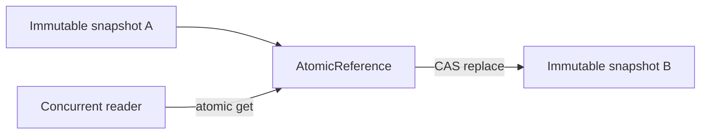

# 85. What is AtomicReference?

> **Section:** Atomic Operations and Lock-Free · **Java baseline:** 8 · [Guide answer](README.md#85-what-is-atomicreference)

`AtomicReference<T>` atomically reads, sets, or conditionally replaces an object reference. It is useful for publishing an immutable snapshot or implementing a CAS state transition.

```java
AtomicReference<Config> config = new AtomicReference<>(initial);
config.updateAndGet(old -> old.withLimit(100));
```

Atomicity applies to the reference, not the object's mutable fields. Prefer immutable values and replace the whole snapshot; update functions may be retried and should have no external side effects.



**Architect insight /pitfall:** Mutating an object after publishing its reference defeats the intended atomic-state model. If the invariant spans several values, package them together in an immutable holder or use a lock.

**Related:** [AtomicInteger](README.md#83-what-is-atomicinteger-used-for) · [Stamped reference](README.md#86-how-does-atomicstampedreference-address-aba) · [CAS](README.md#81-what-is-cas)
