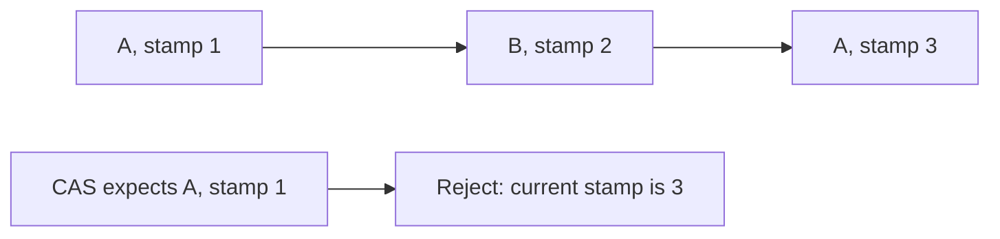

# 86. How does AtomicStampedReference solve the ABA problem?

> **Section:** Atomic Operations and Lock-Free · **Java baseline:** 8 · [Guide answer](README.md#86-how-does-atomicstampedreference-address-aba)

`AtomicStampedReference<T>` atomically pairs a reference with an integer stamp. A CAS compares both. If every relevant logical change advances the stamp, a change from A to B and back to A can be distinguished from an unchanged A.

```java
int[] stamp = new int[1];
Node ref = state.get(stamp);
boolean changed = state.compareAndSet(ref, next, stamp[0], stamp[0] + 1);
```

All participants must follow the stamp-update protocol; integer stamps can wrap, and a stamp does not protect an object's lifetime.



**Architect insight /pitfall:** A version tag detects history only to the extent its update policy does. For custom native structures, reclamation remains a separate problem; prefer proven JDK structures.

**Related:** [ABA](README.md#92-what-is-the-aba-problem) · [AtomicMarkableReference](README.md#87-what-is-atomicmarkablereference) · [ABA remedies](README.md#93-how-can-aba-be-solved)
