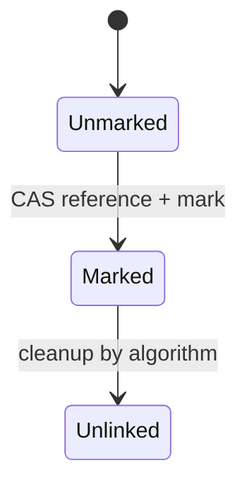

# 87. What is AtomicMarkableReference?

> **Section:** Atomic Operations and Lock-Free · **Java baseline:** 8 · [Guide answer](README.md#87-what-is-atomicmarkablereference)

`AtomicMarkableReference<T>` atomically stores a reference together with one boolean mark. Algorithms often mark a node as logically deleted before physical unlinking.

```java
boolean[] mark = new boolean[1];
Node node = head.get(mark);
boolean changed = head.compareAndSet(node, node, false, true);
```

The mark records only a two-state condition. It does not count successive versions and therefore cannot distinguish every A→B→A history as a stamp can.



**Architect insight /pitfall:** Logical deletion is not memory reclamation. In Java, garbage collection manages object memory, but algorithmic references and ABA concerns still require careful design.

**Related:** [Stamped reference](README.md#86-how-does-atomicstampedreference-address-aba) · [ABA](README.md#92-what-is-the-aba-problem)
