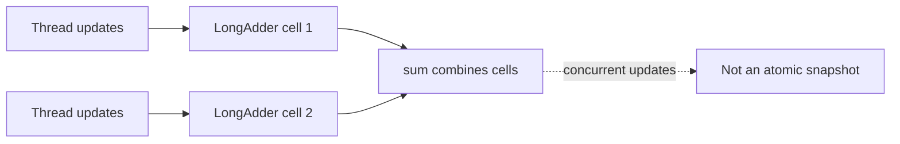

# 88. When to use LongAdder vs AtomicLong?

> **Section:** Atomic Operations and Lock-Free · **Java baseline:** 8 · [Guide answer](README.md#88-longadder-versus-atomiclong)

`LongAdder` spreads concurrent updates across internal cells and combines them in `sum()`. It often improves throughput for contended statistics, such as request counts. While updates continue, `sum()` is not an atomic snapshot.

```java
LongAdder requests = new LongAdder();
requests.increment();
long approximateDuringUpdates = requests.sum();
```

`AtomicLong` provides one linearizable value and is preferable for sequence numbers, exact transitions, and decisions based on the current count.



**Architect insight /pitfall:** Do not use `LongAdder` for balances, limits, or IDs. Choose it only when aggregation throughput is more important than each read being one exact instantaneous value.

**Related:** [AtomicLong](README.md#84-what-is-atomiclong) · [DoubleAdder](README.md#89-what-is-doubleadder)
