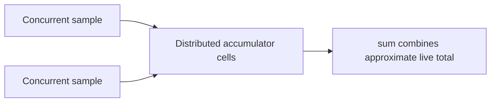

# 89. What is DoubleAdder used for?

> **Section:** Atomic Operations and Lock-Free · **Java baseline:** 8 · [Guide answer](README.md#89-what-is-doubleadder)

`DoubleAdder` is a contention-reducing accumulator for concurrent floating-point totals. It spreads additions across cells and combines them with `sum()`. It is appropriate for metrics, not exact accounting or algorithms that depend on strict update order.

```java
DoubleAdder latencyTotal = new DoubleAdder();
latencyTotal.add(sampleMillis);
double observedTotal = latencyTotal.sum();
```

Floating-point addition is not associative, so different update orders may produce slightly different results. Like `LongAdder`, a sum taken during concurrent updates is not an atomic snapshot.



**Architect insight /pitfall:** Do not use binary floating-point accumulation where exact decimal currency or a consistent transactional snapshot is required. Select the numeric model and synchronization semantics that match the domain.

**Related:** [LongAdder versus AtomicLong](README.md#88-longadder-versus-atomiclong) · [AtomicLong](README.md#84-what-is-atomiclong)
