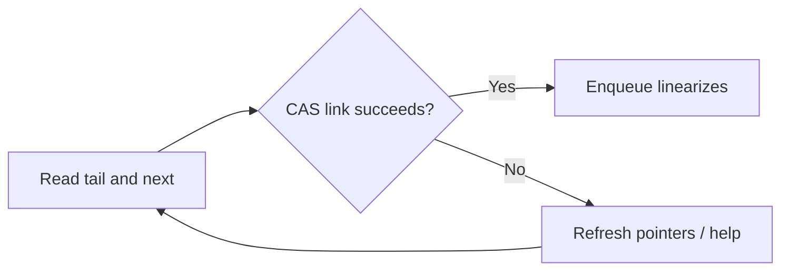

# 90. How do lock-free queues work internally?

> **Section:** Atomic Operations and Lock-Free · **Java baseline:** 8 · [Guide answer](README.md#90-how-do-lock-free-queues-work)

Many lock-free queues link nodes and use CAS to update head or tail pointers. If a competing operation changes a pointer first, the losing operation retries; helping may advance a lagging pointer. `ConcurrentLinkedQueue` is a standard Java non-blocking queue for unbounded use.

```java
Queue<Task> queue = new ConcurrentLinkedQueue<>();
queue.offer(task);
Task next = queue.poll(); // null if empty
```

This queue is not bounded, and custom linked lock-free queues are difficult to prove correct.



**Architect insight /pitfall:** Lock-free pointer algorithms must address ABA, linearizability, progress, and safe reclamation. Prefer JDK concurrent collections over a home-grown queue.

**Related:** [CAS](README.md#81-what-is-cas) · [Lock-free risks](README.md#97-risks-of-lock-free-programming) · [ABA](README.md#92-what-is-the-aba-problem)
