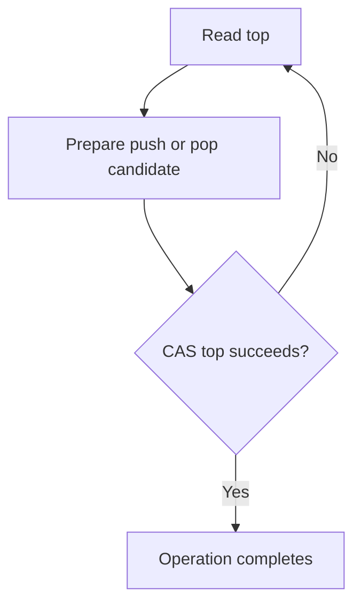

# 91. What is a lock-free stack?

> **Section:** Atomic Operations and Lock-Free · **Java baseline:** 8 · [Guide answer](README.md#91-what-is-a-lock-free-stack)

A classic Treiber stack stores a volatile/atomic top reference. Push creates a node linked to the observed top and CASes top to the new node. Pop reads the top and CASes it to the next node; failure requires retrying with a fresh observation.

```text
push: new.next = observedTop; CAS(top, observedTop, new)
pop:  CAS(top, observedTop, observedTop.next)
```

This sketch omits null handling, memory ordering, ABA, and robust API semantics; prefer a proven concurrent collection.



**Architect insight /pitfall:** A correct CAS loop is not necessarily lock-free as a whole, and one thread can starve. ABA and object reuse can invalidate the assumed top history.

**Related:** [CAS](README.md#81-what-is-cas) · [ABA](README.md#92-what-is-the-aba-problem) · [Lock-free risks](README.md#97-risks-of-lock-free-programming)
