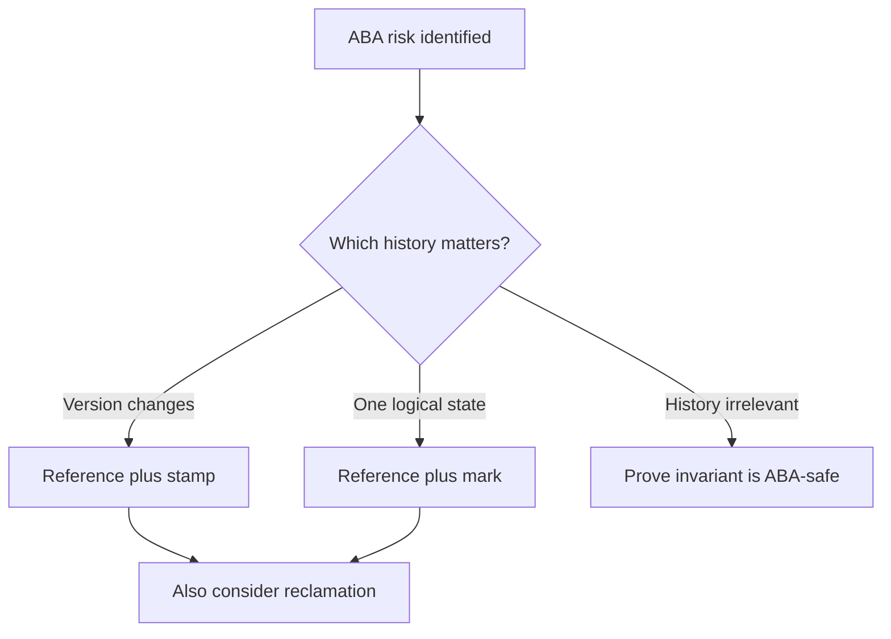

# 93. How do you solve the ABA problem?

> **Section:** Atomic Operations and Lock-Free · **Java baseline:** 8 · [Guide answer](README.md#93-how-can-aba-be-solved)

Choose an ABA remedy based on the correctness invariant. Pair a reference with a monotonically changing stamp using `AtomicStampedReference` when intervening versions matter. Use a mark when the relevant transition is a logical state such as deletion. Alternatively, design the algorithm so A→B→A is harmless.

```java
AtomicStampedReference<Node> top =
    new AtomicStampedReference<>(initial, 0);
```

For native lock-free structures, also use a safe memory-reclamation strategy. A stamp is not a universal solution; it can wrap and does not protect object lifetime.



**Architect insight /pitfall:** Adding tags without a protocol can create false confidence. Prefer established concurrent collections unless profiling and a proof justify custom lock-free code.

**Related:** [ABA](README.md#92-what-is-the-aba-problem) · [Stamped reference](README.md#86-how-does-atomicstampedreference-address-aba) · [Markable reference](README.md#87-what-is-atomicmarkablereference)
