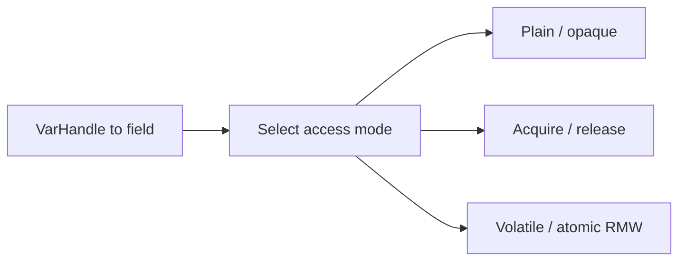

# 94. What are VarHandles?

> **Section:** Atomic Operations and Lock-Free · **Java baseline:** 9+ for `VarHandle`; Java 8 remains the baseline for atomic classes · [Guide answer](README.md#94-what-are-varhandles)

Introduced in Java 9, `VarHandle` provides typed, access-controlled handles to fields and array elements. It supports plain, opaque, acquire/release, volatile, and atomic read-modify-write access modes, enabling low-level concurrency without general-purpose `Unsafe` access.

```java
// Java 9+: declaration and access-mode choice depend on the field
VarHandle handle = MethodHandles.lookup()
    .findVarHandle(State.class, "value", int.class);
int current = (int) handle.getVolatile(state);
```

Use Java 8 `Atomic*` classes when targeting Java 8; this API does not exist there.



**Architect insight /pitfall:** Weaker modes require a precise publication proof. Default to established atomics unless lower-level access modes solve a measured need.

**Related:** [VarHandle versus Unsafe](README.md#95-how-do-varhandles-replace-sunmiscunsafe) · [Fences and CAS](README.md#98-how-does-cas-interact-with-memory-fences)
