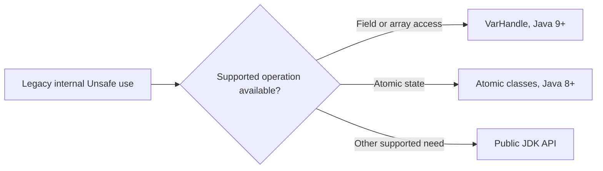

# 95. How do VarHandles replace sun.misc.Unsafe?

> **Section:** Atomic Operations and Lock-Free · **Java baseline:** 9+ for `VarHandle`; Java 8 remains the baseline for atomics · [Guide answer](README.md#95-how-do-varhandles-replace-sunmiscunsafe)

`VarHandle` provides supported, typed access to fields and array elements with explicit memory-ordering modes and atomic operations. It covers many use cases previously implemented using `sun.misc.Unsafe`, without exposing arbitrary memory access. It does not provide every Unsafe capability.

For Java 8 code, use `Atomic*` classes or other supported APIs; `VarHandle` requires Java 9 or newer.

**Architect insight /pitfall:** Do not migrate by mechanically translating calls: memory-ordering semantics must remain correct. Avoid depending on internal APIs, whose accessibility and behavior can change.

**Related:** [VarHandles](README.md#94-what-are-varhandles) · [CAS memory ordering](README.md#98-how-does-cas-interact-with-memory-fences)
