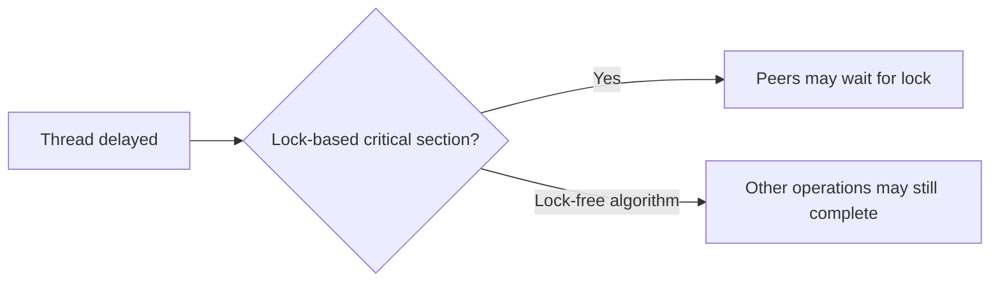

# 96. What are the benefits of lock-free programming?

> **Section:** Atomic Operations and Lock-Free · **Java baseline:** 8 atomic APIs; `VarHandle` Java 9+ · [Guide answer](README.md#96-benefits-of-lock-free-programming)

Lock-free algorithms avoid mutual-exclusion blocking and can prevent a stalled thread from holding a lock that stops all peers. A lock-free progress guarantee means that, system-wide, some operation completes; it does not guarantee every thread succeeds promptly. For short operations under heavy contention, lock-free designs may improve throughput.

**Architect insight /pitfall:** Lock-free is not wait-free or starvation-free. It may increase CPU consumption and complexity. Measure throughput, tail latency, and fairness against a straightforward lock before adopting it.

**Related:** [Risks](README.md#97-risks-of-lock-free-programming) · [CAS](README.md#81-what-is-cas) · [Throughput](README.md#100-how-can-lock-free-structures-improve-throughput)
