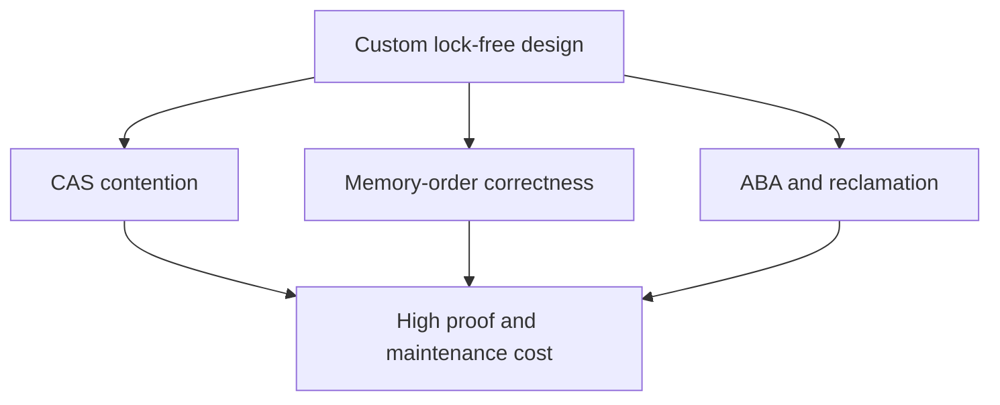

# 97. What are the risks of lock-free programming?

> **Section:** Atomic Operations and Lock-Free · **Java baseline:** 8 atomic APIs; `VarHandle` Java 9+ · [Guide answer](README.md#97-risks-of-lock-free-programming)

Lock-free code risks retry storms, starvation, ABA, subtle publication and memory-order bugs, and difficult-to-prove invariants. Under light contention, retries and cache-coherence traffic can make it slower than a lock. Native structures also need safe memory reclamation.

**Architect insight /pitfall:** Prefer JDK atomics and concurrent collections. Build custom algorithms only after profiling a bottleneck, documenting progress guarantees, and testing interleavings with suitable concurrency tools.

**Related:** [Benefits](README.md#96-benefits-of-lock-free-programming) · [Repeated CAS failure](README.md#99-what-if-cas-fails-repeatedly) · [Lock-free queues](README.md#90-how-do-lock-free-queues-work)
