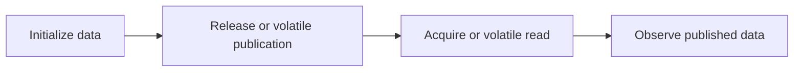

# 98. How does CAS interact with memory fences?

> **Section:** Atomic Operations and Lock-Free · **Java baseline:** 8 atomics; `VarHandle` memory modes require Java 9+ · [Guide answer](README.md#98-how-does-cas-interact-with-memory-fences)

Atomicity and memory ordering are related but distinct. Java atomic classes provide specified volatile-like visibility/order guarantees for their operations. `VarHandle` (Java 9+) exposes modes such as acquire/release and volatile so low-level code can express a narrower ordering when proven correct.

```java
// Java 8+: AtomicReference operations provide the API's specified semantics.
AtomicReference<Config> published = new AtomicReference<>();
published.set(immutableConfig);
Config snapshot = published.get();
```

The Java Memory Model—not a CPU-specific intuition—defines the publication guarantee.



**Architect insight /pitfall:** CAS success alone is not a complete publication argument if the chosen access mode is weaker. Prefer standard atomic APIs and specify the ordering relation required by the invariant.

**Related:** [VarHandles](README.md#94-what-are-varhandles) · [CAS](README.md#81-what-is-cas)
