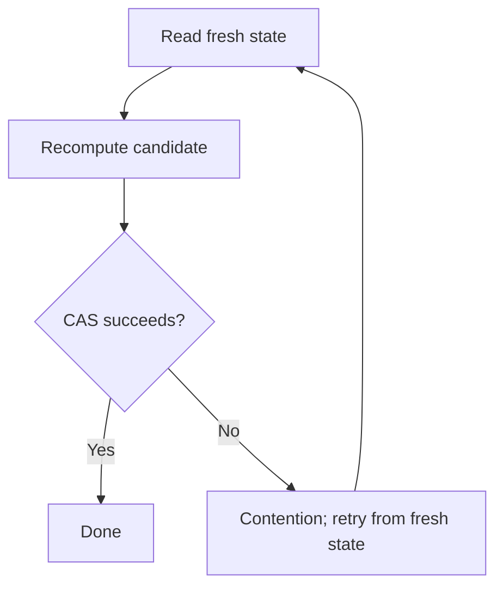

# 99. What happens when CAS fails repeatedly?

> **Section:** Atomic Operations and Lock-Free · **Java baseline:** 8 atomic APIs · [Guide answer](README.md#99-what-if-cas-fails-repeatedly)

On CAS failure, another update changed the observed value. Read the current state again and recompute the candidate from that fresh state; never keep retrying an update derived from stale data.

```java
int observed;
do {
    observed = value.get();
} while (!value.compareAndSet(observed, observed + 1));
```

Repeated failures may indicate contention and wasted CPU. Measure before adding backoff; alternatives include partitioning state, using `LongAdder` for non-exact statistics, or choosing a lock.



**Architect insight /pitfall:** A retry loop can starve one caller even while the system progresses. Ensure the operation is safe to recompute and consider fairness/tail latency, not only aggregate throughput.

**Related:** [CAS](README.md#81-what-is-cas) · [Lock avoidance](README.md#82-how-does-cas-avoid-locks) · [LongAdder tradeoff](README.md#88-longadder-versus-atomiclong)
