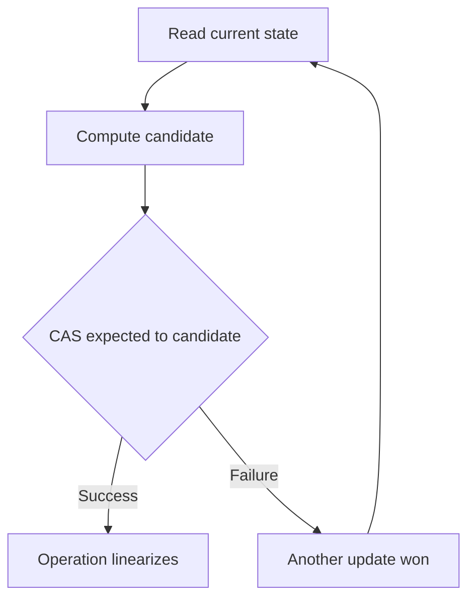
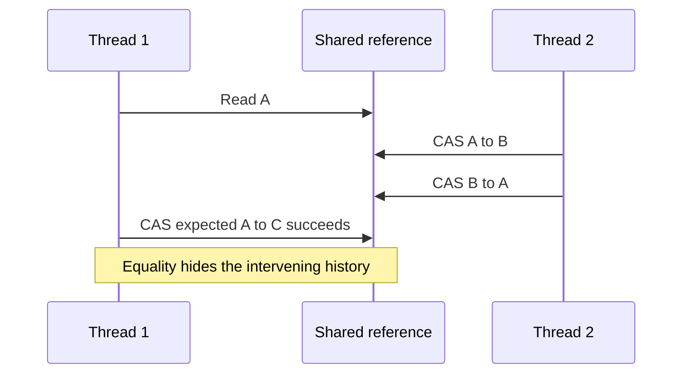
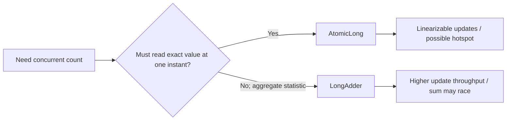

# 5. Atomic Operations and Lock-Free

> Complete guide to questions 81–100 in the [master index](../00-INDEX.md). Java 8 atomic classes are available at the project's baseline; `VarHandle` requires Java 9 or later.

## Answers

### 81. What is CAS?

Compare-and-set (CAS) atomically compares a memory location with an expected value and, only if equal, replaces it with an update value. It reports whether the replacement occurred. CAS is a primitive used by atomic classes and concurrent data structures; it is not an entire algorithm or a guarantee of lock-free progress by itself.

### 82. How does CAS avoid locks?

An algorithm can read a snapshot, compute a candidate, and CAS it into place; on failure it retries from a fresh snapshot. Contending threads do not block on a mutex, but they may repeatedly retry and waste CPU. Correctness still requires handling memory ordering, ABA, progress guarantees, and resource reclamation.

### 83. What is `AtomicInteger` used for?

`AtomicInteger` provides atomic integer reads, writes, compare-and-set, and update operations such as `incrementAndGet`. It is useful for independent counters, state transitions, and bounded CAS loops. It does not protect an invariant spanning multiple variables; use a lock or immutable aggregate reference for that.

### 84. What is `AtomicLong`?

`AtomicLong` supplies atomic long-valued read-modify-write operations, including CAS and arithmetic updates. It is appropriate when each increment must be immediately and exactly observable or when a single atomic state variable is needed. A contended global counter can become a cache-line hotspot; consider `LongAdder` for statistical aggregation.

### 85. What is `AtomicReference`?

`AtomicReference<T>` atomically reads, sets, and conditionally replaces an object reference. It enables immutable-state updates using CAS loops and safe publication of the referenced value. The reference update is atomic, but the referenced mutable object is not; prefer immutable snapshots or coordinate its contents separately.

### 86. How does `AtomicStampedReference` address ABA?

It atomically pairs a reference with an integer stamp. A CAS checks both, so a thread can detect that the reference changed away and back when each logical change advances the stamp. Stamps can wrap and must be updated consistently; this is detection, not automatic protection of the pointed-to object's lifetime.

### 87. What is `AtomicMarkableReference`?

It atomically pairs a reference with one boolean mark. Algorithms commonly use the mark to indicate logical deletion without changing the reference. It detects a particular state transition, but unlike a stamp it cannot distinguish multiple successive versions, and it does not solve reclamation concerns.

### 88. `LongAdder` versus `AtomicLong`

`LongAdder` spreads updates across cells under contention and combines them in `sum()`, improving aggregate update throughput. Its sum is not an atomic snapshot while updates continue and is unsuitable for sequence numbers or decisions requiring an exact instant value. Use `AtomicLong` when each operation's single linearizable value matters.

### 89. What is `DoubleAdder`?

`DoubleAdder` accumulates floating-point values across contention-reducing cells and combines them with `sum()`. It is suited to approximate concurrent statistics such as totals, not exact accounting or order-sensitive calculations: floating-point addition is not associative, and the observed sum may be changing during reads.

### 90. How do lock-free queues work?

Many lock-free queues use CAS to link nodes and advance head/tail references. Enqueue/dequeue operations retry when another thread wins a race; helping logic may advance lagging pointers. Java's `ConcurrentLinkedQueue` is a proven non-blocking queue, but custom implementations must solve ABA, memory reclamation, linearizability, and progress issues.

### 91. What is a lock-free stack?

A common stack stores a top-node reference. Push CASes a new node whose next points at the observed top; pop CASes top to its next. This simple Treiber stack can suffer ABA if a node is removed and a reference reused; production-quality correctness and reclamation make custom stacks hazardous.

### 92. What is the ABA problem?

A thread reads value A, pauses, and later sees A again, so CAS succeeds even though another thread changed A to B and back to A. The bitwise value is equal but the history or associated state may have changed. It matters when the algorithm assumes no intervening transition.

### 93. How can ABA be solved?

Use a version/stamp paired with the value (`AtomicStampedReference`), a mark when only a logical state change matters, or a design whose correctness is independent of the intervening history. For native lock-free structures also address safe memory reclamation. Choose based on the invariant; tagging alone is not universal.

### 94. What are `VarHandle`s?

Introduced in Java 9, `VarHandle` provides typed, access-controlled variable handles with plain, opaque, acquire/release, volatile, and atomic read-modify-write modes. It allows low-level concurrency code without exposing arbitrary memory access. Pick the weakest ordering mode that proves the invariant; default to established atomic APIs when possible.

### 95. How do `VarHandle`s replace `sun.misc.Unsafe`?

VarHandles cover many field/array access and atomic-update use cases with explicit access modes and normal access checks. They do not reproduce every Unsafe capability, especially arbitrary off-heap and VM-internal operations. Prefer supported APIs (`VarHandle`, `Atomic*`, `ByteBuffer`, or foreign-memory APIs in newer JDKs) over internal APIs.

### 96. Benefits of lock-free programming

Well-designed lock-free algorithms can avoid mutex convoying and priority inversion and guarantee system-wide progress: some operation completes despite a stalled thread. They can improve throughput for short, high-contention operations. Lock-free is not wait-free; an individual thread may starve, and the design cost is substantial.

### 97. Risks of lock-free programming

Risks include retry storms, starvation, subtle memory-order bugs, ABA, safe-reclamation problems, poor performance under low contention, and code that is hard to verify. Prefer JDK concurrent structures and atomic classes. Build custom lock-free algorithms only when profiling shows a bottleneck and expertise/testing can justify the maintenance cost.

### 98. How does CAS interact with memory fences?

CAS APIs have defined memory-ordering semantics, often volatile-like for Java atomic classes; VarHandle exposes weaker and stronger modes explicitly. The operation's atomic comparison alone is not the whole publication protocol. Match acquire/release or volatile ordering to the data being published and rely on the Java specification.

### 99. What if CAS fails repeatedly?

The thread loops, rereads current state, and recomputes the candidate; repeated failures waste CPU and may indicate high contention or an incorrect retry design. Add backoff only when measurements support it, or partition state/use a lock or adder. Never retry with stale derived state.

### 100. How can lock-free structures improve throughput?

They may allow independent operations to progress without serializing on one mutex, particularly when operations are short and contention is high. They can also perform worse due to cache-coherence traffic and retries. Measure throughput, tail latency, CPU use, and fairness under realistic load before choosing lock-free.

## Diagrams

### CAS retry loop

### ABA history

### Contended counter choices

## Decision checklist

- Define the required progress guarantee: blocking, obstruction-free, lock-free, or wait-free.
- Prefer JDK implementations; do not assume CAS makes an algorithm lock-free or correct.
- Use the simplest atomic abstraction that covers the full invariant.
- Benchmark contention and tail behavior, not just uncontended microbenchmarks.
