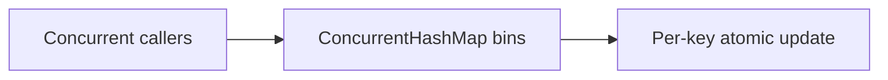

# 101. How does ConcurrentHashMap work internally?

> **Section:** 6. Concurrent Collections · **Level:** Practitioner to architect

## TL;DR

Fine-grained coordination supports concurrent map access without a global lock.

## How it works

It is a hash table supporting concurrent retrieval and updates. Modern implementations coordinate updates at a bin-level granularity using volatile/CAS operations and synchronization when needed; heavily collided bins may use tree structures. Reads generally do not lock the whole map. Internal mechanics are implementation details—depend on its documented API semantics.

## Example

```java
map.compute(key, (k, oldValue) -> oldValue == null ? 1 : oldValue + 1);
```

## Mermaid diagram



## Architect insight

Use atomic per-key methods for read-modify-write logic; they do not make traversal transactional.

## Common pitfall

Hot keys and collisions still contend; avoid correctness assumptions about undocumented internals.

## Related questions

- [Q 102 — What was bucket segmentation?](<102.%20What%20was%20bucket%20segmentation.md>)
- [Section guide](<README.md#101-how-does-concurrenthashmap-work-internally>)