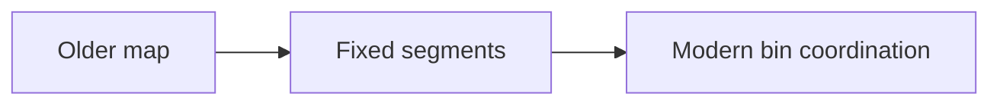

# 102. What is bucket segmentation in ConcurrentHashMap?

> **Section:** 6. Concurrent Collections · **Level:** Practitioner to architect

## TL;DR

Bucket segmentation is the historical, pre-Java-8 approach to limiting contention.

## How it works

Older `ConcurrentHashMap` implementations partitioned the table into independently locked segments. This bounded lock contention but tied concurrency to a fixed number of segments. Java 8-era implementations removed the public/internal segment architecture in favor of finer-grained bin coordination and CAS; do not tune modern behavior using old segment-count advice.

## Example

```java
// Older implementations partitioned buckets into locked segments.
```

## Mermaid diagram



## Architect insight

Recognize segmentation as historical context when reading old tuning advice.

## Common pitfall

Do not tune modern maps using old segment-count guidance.

## Related questions

- [Q 101 — How does ConcurrentHashMap work internally?](<101.%20How%20does%20ConcurrentHashMap%20work%20internally.md>)
- [Q 103 — How did ConcurrentHashMap change after Java 8?](<103.%20How%20did%20ConcurrentHashMap%20change%20after%20Java%208.md>)
- [Section guide](<README.md#102-what-was-bucket-segmentation>)