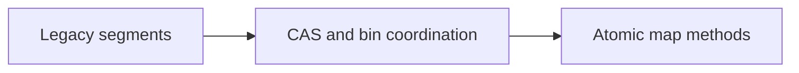

# 103. How did ConcurrentHashMap change after Java 8?

> **Section:** 6. Concurrent Collections · **Level:** Practitioner to architect

## TL;DR

Java 8-era implementations replaced fixed segments with finer-grained coordination.

## How it works

The implementation moved away from fixed segments toward CAS and per-bin synchronization, tree bins for collision-heavy buckets, and cooperative resizing. Its API also offers atomic per-key methods such as `compute` and `merge`. These are not promises about exact locking or performance across every JDK release.

## Example

```java
map.merge(word, 1, Integer::sum);
```

## Mermaid diagram



## Architect insight

Target documented API behavior rather than a benchmark-specific implementation detail.

## Common pitfall

Exact locking, treeification, and resize behavior can vary by JDK.

## Related questions

- [Q 102 — What was bucket segmentation?](<102.%20What%20was%20bucket%20segmentation.md>)
- [Q 104 — What is its performance advantage?](<104.%20What%20is%20its%20performance%20advantage.md>)
- [Section guide](<README.md#103-how-did-concurrenthashmap-change-after-java-8>)