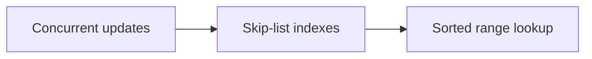

# 108. How does ConcurrentSkipListMap work?

> **Section:** 6. Concurrent Collections · **Level:** Practitioner to architect

## TL;DR

Skip-list levels provide concurrent ordered lookup and navigation.

## How it works

It is a concurrent ordered map organized as a probabilistic skip list. Multiple index levels speed search while preserving sorted traversal and navigable range operations. Reads and updates coordinate without one global map lock, but it is generally more expensive than a hash map when ordering is unnecessary.

## Example

```java
ConcurrentSkipListMap<Integer, String> scores = new ConcurrentSkipListMap<>();
```

## Mermaid diagram



## Architect insight

Choose it for sorted access, ranges, and predecessor/successor queries.

## Common pitfall

Range views and traversal are weakly consistent, not transactional snapshots.

## Related questions

- [Q 107 — Trade-offs of copy-on-write collections](<107.%20Trade-offs%20of%20copy-on-write%20collections.md>)
- [Q 109 — What is ConcurrentSkipListSet?](<109.%20What%20is%20ConcurrentSkipListSet.md>)
- [Section guide](<README.md#108-how-does-concurrentskiplistmap-work>)