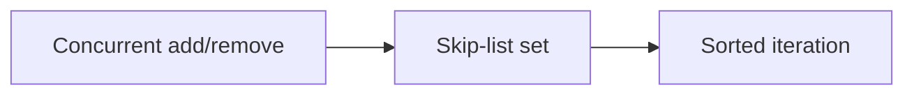

# 109. What is a ConcurrentSkipListSet?

> **Section:** 6. Concurrent Collections · **Level:** Practitioner to architect

## TL;DR

ConcurrentSkipListSet is a concurrent sorted set backed by skip-list mechanics.

## How it works

It is a concurrent sorted set backed by a skip-list map. It offers ordered iteration, range views, and navigational methods with concurrent updates. Its weakly consistent iteration is not a transactional snapshot; use it when sorted concurrent access is needed rather than for hash-set speed.

## Example

```java
ConcurrentSkipListSet<String> active = new ConcurrentSkipListSet<>();
```

## Mermaid diagram



## Architect insight

Use when order and navigation are requirements; otherwise a hash set is often simpler.

## Common pitfall

Sorted access costs more, and traversals are not isolated snapshots.

## Related questions

- [Q 108 — How does ConcurrentSkipListMap work?](<108.%20How%20does%20ConcurrentSkipListMap%20work.md>)
- [Q 110 — What is a weakly consistent iterator?](<110.%20What%20is%20a%20weakly%20consistent%20iterator.md>)
- [Section guide](<README.md#109-what-is-concurrentskiplistset>)