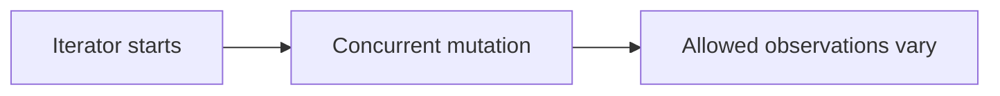

# 110. What does “weakly consistent iterator” mean?

> **Section:** 6. Concurrent Collections · **Level:** Practitioner to architect

## TL;DR

A weakly consistent iterator tolerates concurrent changes without promising an exact snapshot.

## How it works

It tolerates concurrent modification without throwing `ConcurrentModificationException`. It traverses elements according to the collection's contract and may reflect some updates made after creation, but need not reflect all of them. Do not use it to compute an exact snapshot or enforce a multi-element invariant.

## Example

```java
for (String key : concurrentMap.keySet()) process(key);
```

## Mermaid diagram



## Architect insight

Suitable for best-effort monitoring or cleanup; coordinate when an exact inventory is required.

## Common pitfall

Do not derive invariant-sensitive totals as though traversal observed one instant.

## Related questions

- [Q 109 — What is ConcurrentSkipListSet?](<109.%20What%20is%20ConcurrentSkipListSet.md>)
- [Q 111 — Weakly consistent versus fail-fast iterators](<111.%20Weakly%20consistent%20versus%20fail-fast%20iterators.md>)
- [Section guide](<README.md#110-what-is-a-weakly-consistent-iterator>)