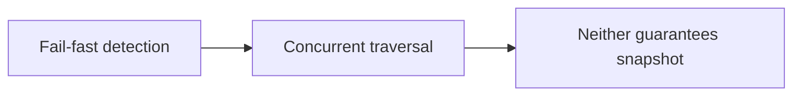

# 111. How are weakly consistent iterators different from fail-fast ones?

> **Section:** 6. Concurrent Collections · **Level:** Practitioner to architect

## TL;DR

Fail-fast is a best-effort bug detector; weak consistency is meant for concurrent traversal.

## How it works

Fail-fast iterators are best-effort bug detectors and may throw when structural mutation is detected; they do not make an unsafe collection thread-safe. Weakly consistent iterators are designed for concurrent collections and continue under mutation with documented visibility limits. Neither is a general atomic snapshot.

## Example

```java
// Use a shared lock or immutable copy for an exact traversal.
```

## Mermaid diagram



## Architect insight

Use a lock or immutable snapshot when the whole traversal must see one state.

## Common pitfall

Catching ConcurrentModificationException is not a synchronization strategy.

## Related questions

- [Q 110 — What is a weakly consistent iterator?](<110.%20What%20is%20a%20weakly%20consistent%20iterator.md>)
- [Q 112 — Synchronized versus concurrent collections](<112.%20Synchronized%20versus%20concurrent%20collections.md>)
- [Section guide](<README.md>)