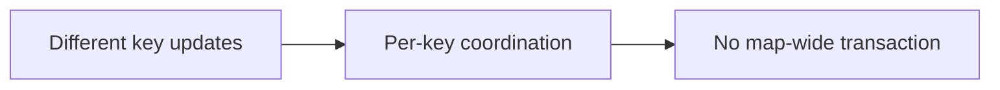

# 114. What happens when multiple threads modify ConcurrentHashMap?

> **Section:** 6. Concurrent Collections · **Level:** Practitioner to architect

## TL;DR

ConcurrentHashMap coordinates updates at operation and mapping granularity, not as a transaction.

## How it works

Operations on different keys can proceed concurrently, while updates to a hot key or colliding bins may contend. Per-key methods such as `putIfAbsent`, `compute`, and `merge` provide atomicity for that mapping. Do not assume a sequence of map calls or a whole-map traversal is one transaction.

## Example

```java
counts.compute(key, (k, v) -> v == null ? 1 : v + 1);
```

## Mermaid diagram



## Architect insight

Keep per-key transitions inside atomic mapping methods and keep callbacks short.

## Common pitfall

A series of calls and a whole-map traversal do not become atomic.

## Related questions

- [Q 113 — When prefer synchronized collections?](<113.%20When%20prefer%20synchronized%20collections.md>)
- [Q 115 — How do concurrent collections ensure safety?](<115.%20How%20do%20concurrent%20collections%20ensure%20safety.md>)
- [Section guide](<README.md#114-concurrent-modifications-to-concurrenthashmap>)