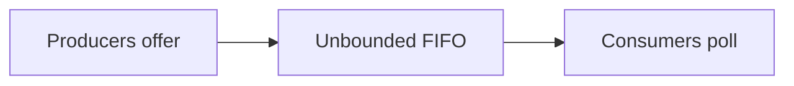

# 116. What is ConcurrentLinkedQueue?

> **Section:** 6. Concurrent Collections · **Level:** Practitioner to architect

## TL;DR

ConcurrentLinkedQueue is an unbounded, non-blocking FIFO queue.

## How it works

It is an unbounded, non-blocking FIFO queue intended for concurrent producers and consumers. It does not block when empty and has no capacity-based backpressure; callers must provide admission limits if demand can outrun processing. `size()` traverses and may be inaccurate during concurrent changes.

## Example

```java
Queue<Job> queue = new ConcurrentLinkedQueue<>();
```

## Mermaid diagram



## Architect insight

Pair it with admission control if producers can outrun consumers.

## Common pitfall

No capacity backpressure is built in; size can be slow and inaccurate during updates.

## Related questions

- [Q 115 — How do concurrent collections ensure safety?](<115.%20How%20do%20concurrent%20collections%20ensure%20safety.md>)
- [Q 117 — ConcurrentLinkedDeque versus queue](<117.%20ConcurrentLinkedDeque%20versus%20queue.md>)
- [Section guide](<README.md#116-what-is-concurrentlinkedqueue>)