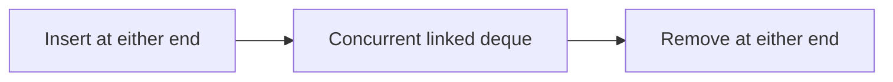

# 117. How does ConcurrentLinkedDeque differ?

> **Section:** 6. Concurrent Collections · **Level:** Practitioner to architect

## TL;DR

ConcurrentLinkedDeque supports non-blocking operations at both ends; a queue is FIFO.

## How it works

`ConcurrentLinkedDeque` supports non-blocking insertion and removal at both ends, whereas `ConcurrentLinkedQueue` is FIFO with tail insertion/head removal. The deque can model work stealing or double-ended scheduling, but its broader API does not make it bounded or blocking.

## Example

```java
deque.offerFirst(task); Task next = deque.pollLast();
```

## Mermaid diagram



## Architect insight

Choose a deque when double-ended scheduling is required.

## Common pitfall

Its broader API still gives no capacity limit or producer throttling.

## Related questions

- [Q 116 — What is ConcurrentLinkedQueue?](<116.%20What%20is%20ConcurrentLinkedQueue.md>)
- [Q 118 — How does LinkedBlockingDeque work?](<118.%20How%20does%20LinkedBlockingDeque%20work.md>)
- [Section guide](<README.md#117-concurrentlinkeddeque-versus-queue>)