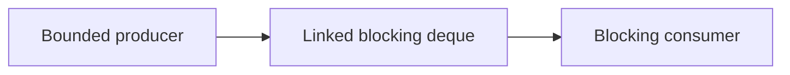

# 118. How does LinkedBlockingDeque work?

> **Section:** 6. Concurrent Collections · **Level:** Practitioner to architect

## TL;DR

LinkedBlockingDeque offers blocking, optionally bounded insertion and removal at either end.

## How it works

It is a optionally bounded, node-linked blocking deque. Producers can insert at either end and consumers remove from either end; blocking and timed operations enable handoff/backpressure. Each node costs memory and allocation, so set a meaningful capacity and use array-backed alternatives when predictable allocation matters.

## Example

```java
BlockingDeque<Job> jobs = new LinkedBlockingDeque<>(256);
```

## Mermaid diagram



## Architect insight

Set capacity from latency and memory budgets and define timeout or rejection behavior.

## Common pitfall

The no-argument form is effectively unbounded; blocking does not itself bound memory.

## Related questions

- [Q 117 — ConcurrentLinkedDeque versus queue](<117.%20ConcurrentLinkedDeque%20versus%20queue.md>)
- [Q 119 — How do concurrent navigable maps work?](<119.%20How%20do%20concurrent%20navigable%20maps%20work.md>)
- [Section guide](<README.md#118-how-does-linkedblockingdeque-work>)