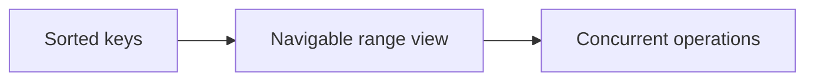

# 119. How do concurrent navigable maps work?

> **Section:** 6. Concurrent Collections · **Level:** Practitioner to architect

## TL;DR

Concurrent navigable maps combine sorted range/navigation operations with concurrent access.

## How it works

Concurrent navigable maps, notably `ConcurrentSkipListMap`, provide sorted keys, inclusive/exclusive range views, and predecessor/successor queries while supporting concurrent operations. Views are live and weakly consistent, not isolated transactions. Use explicit coordination if a range read and subsequent update must be atomic together.

## Example

```java
NavigableMap<Integer, Task> range = tasks.subMap(low, true, high, false);
```

## Mermaid diagram



## Architect insight

Use explicit coordination if selecting a range then updating it must be atomic.

## Common pitfall

Range views are live and weakly consistent, not snapshots.

## Related questions

- [Q 118 — How does LinkedBlockingDeque work?](<118.%20How%20does%20LinkedBlockingDeque%20work.md>)
- [Q 120 — Use cases for concurrent collections](<120.%20Use%20cases%20for%20concurrent%20collections.md>)
- [Section guide](<README.md#119-how-do-concurrent-navigable-maps-work>)