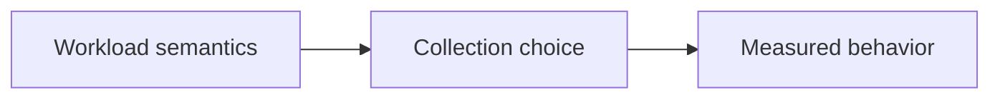

# 120. What are the use cases for concurrent collections?

> **Section:** 6. Concurrent Collections · **Level:** Practitioner to architect

## TL;DR

Choose by ordering, consistency, capacity, and blocking semantics rather than by label.

## How it works

Use `ConcurrentHashMap` for shared key-value state, copy-on-write lists for read-mostly listeners, blocking queues for bounded producer/consumer flow, concurrent linked queues for non-blocking handoff, and skip lists for sorted concurrent ranges. Choose on semantics, capacity, ordering, snapshot needs, and measured contention.

## Example

```java
BlockingQueue<Job> work = new ArrayBlockingQueue<>(128);
```

## Mermaid diagram



## Architect insight

Benchmark representative contention and memory after choosing required semantics.

## Common pitfall

An unbounded queue or weak observation can break system-level requirements.

## Related questions

- [Q 119 — How do concurrent navigable maps work?](<119.%20How%20do%20concurrent%20navigable%20maps%20work.md>)
- [Section guide](<README.md#120-use-cases-for-concurrent-collections>)