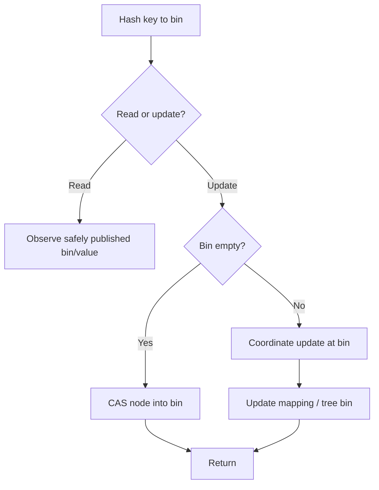
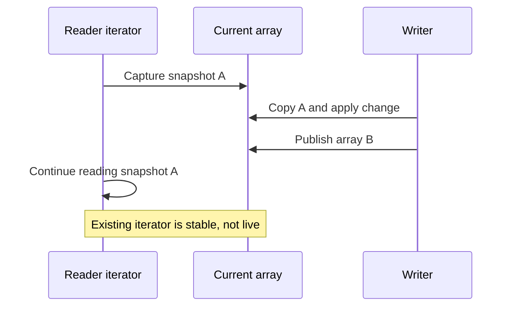
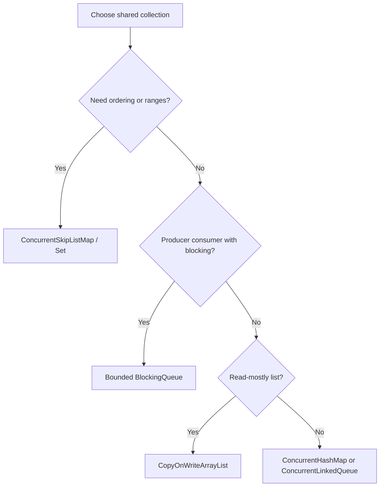

# 6. Concurrent Collections

> Complete guide to questions 101–120 in the [master index](../00-INDEX.md). Prefer a collection whose consistency and ordering semantics match the use case.

**Related code:** [`producerconsumer/App.java`](../../src/com/java/producerconsumer/App.java), [`countdownlatches/App.java`](../../src/com/java/countdownlatches/App.java).

## Answers

### 101. How does `ConcurrentHashMap` work internally?

It is a hash table supporting concurrent retrieval and updates. Modern implementations coordinate updates at a bin-level granularity using volatile/CAS operations and synchronization when needed; heavily collided bins may use tree structures. Reads generally do not lock the whole map. Internal mechanics are implementation details—depend on its documented API semantics.

### 102. What was bucket segmentation?

Older `ConcurrentHashMap` implementations partitioned the table into independently locked segments. This bounded lock contention but tied concurrency to a fixed number of segments. Java 8-era implementations removed the public/internal segment architecture in favor of finer-grained bin coordination and CAS; do not tune modern behavior using old segment-count advice.

### 103. How did `ConcurrentHashMap` change after Java 8?

The implementation moved away from fixed segments toward CAS and per-bin synchronization, tree bins for collision-heavy buckets, and cooperative resizing. Its API also offers atomic per-key methods such as `compute` and `merge`. These are not promises about exact locking or performance across every JDK release.

### 104. What is its performance advantage?

Independent keys can often be read or updated concurrently without a global map lock, yielding better throughput than synchronizing every operation on one wrapper. Hot keys and hash collisions still contend. Map-wide operations and aggregate observations may not be atomic snapshots during concurrent updates.

### 105. How does `CopyOnWriteArrayList` work?

Mutations create and publish a new backing array; readers access a stable snapshot without locking. Iterators retain the array snapshot from iterator creation and do not observe later changes. A write-heavy workload pays copying and allocation costs proportional to list size.

### 106. When use `CopyOnWriteArrayList`?

Use it for small, read-mostly collections where iteration greatly outnumbers mutation, such as listener registries. It provides simple snapshot iteration without reader coordination. Avoid it for large lists or frequent writes, and remember iterators are stale snapshots rather than live views.

### 107. Trade-offs of copy-on-write collections

Readers are cheap and iteration is safe, but every mutation copies the array, concurrent writers serialize, and iterators retain old arrays until released. This increases allocation and garbage-collection pressure. Evaluate write frequency, collection size, and how stale a reader may be.

### 108. How does `ConcurrentSkipListMap` work?

It is a concurrent ordered map organized as a probabilistic skip list. Multiple index levels speed search while preserving sorted traversal and navigable range operations. Reads and updates coordinate without one global map lock, but it is generally more expensive than a hash map when ordering is unnecessary.

### 109. What is `ConcurrentSkipListSet`?

It is a concurrent sorted set backed by a skip-list map. It offers ordered iteration, range views, and navigational methods with concurrent updates. Its weakly consistent iteration is not a transactional snapshot; use it when sorted concurrent access is needed rather than for hash-set speed.

### 110. What is a weakly consistent iterator?

It tolerates concurrent modification without throwing `ConcurrentModificationException`. It traverses elements according to the collection's contract and may reflect some updates made after creation, but need not reflect all of them. Do not use it to compute an exact snapshot or enforce a multi-element invariant.

### 111. Weakly consistent versus fail-fast iterators

Fail-fast iterators are best-effort bug detectors and may throw when structural mutation is detected; they do not make an unsafe collection thread-safe. Weakly consistent iterators are designed for concurrent collections and continue under mutation with documented visibility limits. Neither is a general atomic snapshot.

### 112. Synchronized versus concurrent collections

Synchronized wrappers typically serialize each method using one mutex; iteration still requires external synchronization around the entire traversal. Concurrent collections use data structures and finer-grained coordination designed for concurrent access. Select by required atomicity: a wrapper can be adequate for simple low-contention state.

### 113. When prefer synchronized collections?

Prefer a synchronized wrapper for small, low-contention legacy structures or when a single lock must protect a compound invariant across operations. Synchronize the entire iteration and every related access on the wrapper. For contention or independent concurrent updates, use a concurrent collection instead.

### 114. Concurrent modifications to `ConcurrentHashMap`

Operations on different keys can proceed concurrently, while updates to a hot key or colliding bins may contend. Per-key methods such as `putIfAbsent`, `compute`, and `merge` provide atomicity for that mapping. Do not assume a sequence of map calls or a whole-map traversal is one transaction.

### 115. How do concurrent collections ensure safety?

They combine synchronization, CAS, volatile state, immutable snapshots, or lock-free algorithms according to their design. Their public contracts specify allowed concurrent observations. Thread safety is operation-specific: composing individually safe calls does not automatically make the sequence atomic.

### 116. What is `ConcurrentLinkedQueue`?

It is an unbounded, non-blocking FIFO queue intended for concurrent producers and consumers. It does not block when empty and has no capacity-based backpressure; callers must provide admission limits if demand can outrun processing. `size()` traverses and may be inaccurate during concurrent changes.

### 117. `ConcurrentLinkedDeque` versus queue

`ConcurrentLinkedDeque` supports non-blocking insertion and removal at both ends, whereas `ConcurrentLinkedQueue` is FIFO with tail insertion/head removal. The deque can model work stealing or double-ended scheduling, but its broader API does not make it bounded or blocking.

### 118. How does `LinkedBlockingDeque` work?

It is a optionally bounded, node-linked blocking deque. Producers can insert at either end and consumers remove from either end; blocking and timed operations enable handoff/backpressure. Each node costs memory and allocation, so set a meaningful capacity and use array-backed alternatives when predictable allocation matters.

### 119. How do concurrent navigable maps work?

Concurrent navigable maps, notably `ConcurrentSkipListMap`, provide sorted keys, inclusive/exclusive range views, and predecessor/successor queries while supporting concurrent operations. Views are live and weakly consistent, not isolated transactions. Use explicit coordination if a range read and subsequent update must be atomic together.

### 120. Use cases for concurrent collections

Use `ConcurrentHashMap` for shared key-value state, copy-on-write lists for read-mostly listeners, blocking queues for bounded producer/consumer flow, concurrent linked queues for non-blocking handoff, and skip lists for sorted concurrent ranges. Choose on semantics, capacity, ordering, snapshot needs, and measured contention.

## Diagrams

### Concurrent map access

### Copy-on-write snapshots

### Selecting a collection

## Review checklist

- Verify whether the API promises a snapshot, weak consistency, or atomicity only per operation/key.
- Prefer bounded queues when producers can outrun consumers.
- Avoid `size()` or iteration as a synchronization mechanism for concurrent structures.
- Do not wrap a concurrent collection in extra locks unless a larger invariant requires them.
