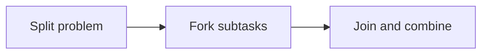

# 125. What is the Fork/Join divide-and-conquer pattern?

> **Section:** 7. Concurrency Patterns · **Level:** Practitioner to architect

## TL;DR

Fork/join recursively splits work and combines results; work stealing balances tasks.

## How it works

Split a large problem into independent subtasks, fork some, compute one locally, then join and combine results. Work stealing balances tasks across workers. Set a minimum task size so overhead does not dominate; avoid shared mutable accumulation and unmanaged blocking.

## Example

```java
long result = pool.invoke(new RangeSumTask(values, 0, values.length));
```

## Mermaid diagram



## Architect insight

Choose a measured base-case threshold to amortize scheduling.

## Common pitfall

Tiny tasks and unmanaged blocking can overwhelm the pool.

## Related questions

- [Q 124 — Reader-Writer with ReadWriteLock](<124.%20Reader-Writer%20with%20ReadWriteLock.md>)
- [Q 126 — What is the Actor model?](<126.%20What%20is%20the%20Actor%20model.md>)
- [Section guide](<README.md#125-forkjoin-divide-and-conquer>)