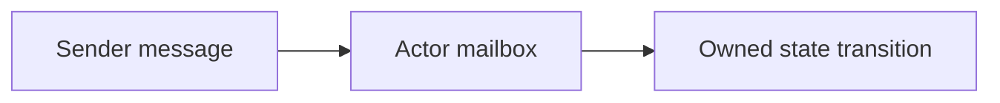

# 126. What is the Actor model in concurrency?

> **Section:** 7. Concurrency Patterns · **Level:** Practitioner to architect

## TL;DR

An actor owns private state, handles one message at a time, and communicates asynchronously.

## How it works

An actor owns private state, processes one message at a time, and communicates with other actors by asynchronous messages. Mailboxes serialize each actor's state transitions, reducing shared-memory locking. Actors still need mailbox capacity, supervision, delivery, ordering, and restart policies.

## Example

```java
actor.tell(new AddItem(item));
```

## Mermaid diagram



## Architect insight

Model ownership, mailbox capacity, ordering, delivery, supervision, and restart explicitly.

## Common pitfall

Unbounded mailboxes can grow without limit; a hot actor can become a bottleneck.

## Related questions

- [Q 125 — Fork/Join divide and conquer](<125.%20ForkJoin%20divide%20and%20conquer.md>)
- [Q 127 — How do actors avoid shared-state issues?](<127.%20How%20do%20actors%20avoid%20shared-state%20issues.md>)
- [Section guide](<README.md#126-what-is-the-actor-model>)