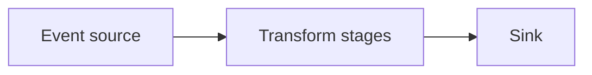

# 129. What is an event-driven pipeline?

> **Section:** 7. Concurrency Patterns · **Level:** Practitioner to architect

## TL;DR

An event-driven pipeline passes events through asynchronous stages.

## How it works

It processes events through stages connected by queues or asynchronous callbacks. Stages can be independently scaled and isolated, but boundaries introduce buffering, ordering, retries, and observability requirements. Specify event ownership, schema, delivery semantics, and overload policy at every stage.

## Example

```java
source.publish(event); transformStage.accept(event); persistStage.accept(event);
```

## Mermaid diagram



## Architect insight

Instrument queue depth, latency, retries, and drops at every boundary.

## Common pitfall

Without capacity limits, async stages can move overload downstream.

## Related questions

- [Q 128 — Immutability's role](<128.%20Immutability%27s%20role.md>)
- [Q 130 — Reactive Streams as a pipeline](<130.%20Reactive%20Streams%20as%20a%20pipeline.md>)
- [Section guide](<README.md>)