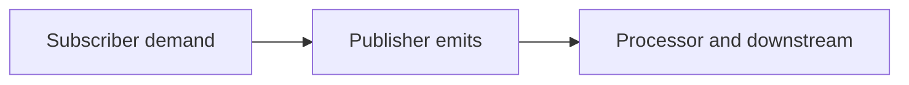

# 130. How can reactive streams model pipelines?

> **Section:** 7. Concurrency Patterns · **Level:** Practitioner to architect

## TL;DR

Reactive Streams coordinates publishers and subscribers through explicit item demand.

## How it works

Reactive Streams models asynchronous publishers, subscribers, and processors with a demand protocol. A subscriber requests a number of items; publishers must not emit more than requested. This supports bounded flow across asynchronous stages, while cancellation and terminal errors are part of the protocol.

## Example

```java
subscription.request(32);
```

## Mermaid diagram



## Architect insight

Demand can bound in-flight work only when every stage honors the protocol.

## Common pitfall

Cancellation and terminal errors are part of the protocol; unbounded demand removes throttling.

## Related questions

- [Q 129 — What is an event-driven pipeline?](<129.%20What%20is%20an%20event-driven%20pipeline.md>)
- [Q 131 — What is backpressure?](<131.%20What%20is%20backpressure.md>)
- [Section guide](<README.md#130-reactive-streams-as-a-pipeline>)