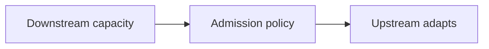

# 131. What is backpressure in reactive streams?

> **Section:** 7. Concurrency Patterns · **Level:** Practitioner to architect

## TL;DR

Backpressure lets downstream capacity constrain upstream production.

## How it works

Backpressure makes downstream capacity influence upstream production instead of allowing an unbounded backlog. It may be expressed as item demand, bounded queues, rejection, shedding, or rate limiting. Choose whether to slow, buffer, drop, or fail and make that policy visible to callers and operators.

## Example

```java
if (!queue.offer(item)) return overloaded();
```

## Mermaid diagram



## Architect insight

Choose whether to slow, buffer, drop, or fail and expose that policy.

## Common pitfall

An unbounded queue is delayed failure, not backpressure.

## Related questions

- [Q 130 — Reactive Streams as a pipeline](<130.%20Reactive%20Streams%20as%20a%20pipeline.md>)
- [Q 132 — What is the Disruptor pattern?](<132.%20What%20is%20the%20Disruptor%20pattern.md>)
- [Section guide](<README.md#131-what-is-backpressure>)