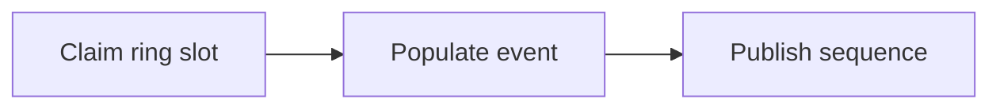

# 132. What is the Disruptor pattern?

> **Section:** 7. Concurrency Patterns · **Level:** Practitioner to architect

## TL;DR

The Disruptor uses a preallocated ring buffer and sequence coordination for specialized high-throughput pipelines.

## How it works

The LMAX Disruptor is a high-throughput inter-thread messaging design built around a preallocated ring buffer, sequence numbers, and explicit producer/consumer coordination. It reduces allocation and contention in suitable pipelines but requires careful capacity, sequencing, wait strategy, and event reuse discipline. It is not a general-purpose queue replacement.

## Example

```java
long sequence = ringBuffer.next(); try { ringBuffer.get(sequence).setValue(value); } finally { ringBuffer.publish(sequence); }
```

## Mermaid diagram



## Architect insight

Adopt only when measured performance justifies complexity and operational expertise.

## Common pitfall

A missing publish can leave a sequence gap; reused event state must not escape unsafely.

## Related questions

- [Q 131 — What is backpressure?](<131.%20What%20is%20backpressure.md>)
- [Q 133 — What is thread confinement?](<133.%20What%20is%20thread%20confinement.md>)
- [Section guide](<README.md#132-what-is-the-disruptor-pattern>)