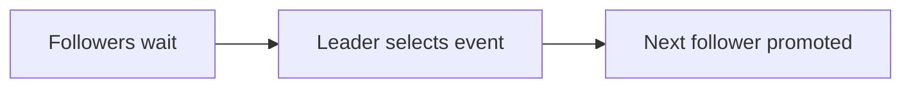

# 135. What is the Leader-Follower pattern?

> **Section:** 7. Concurrency Patterns · **Level:** Practitioner to architect

## TL;DR

Leader-follower assigns one worker to wait for events and promotes a follower after selection.

## How it works

A group of workers share an event source: one leader waits for the next event, then promotes a follower and handles or dispatches that event. This can reduce contention around event selection and thread wakeups. The design adds role handoff complexity; most applications should use a tested event-loop or executor framework.

## Example

```java
// Leader selects an event, promotes a follower, then dispatches work.
```

## Mermaid diagram



## Architect insight

Prefer a tested framework unless profiling proves event selection is a bottleneck.

## Common pitfall

Role handoff and leader failure need explicit recovery.

## Related questions

- [Q 134 — What is thread-per-message?](<134.%20What%20is%20thread-per-message.md>)
- [Q 136 — What is Half-Sync/Half-Async?](<136.%20What%20is%20Half-SyncHalf-Async.md>)
- [Section guide](<README.md>)