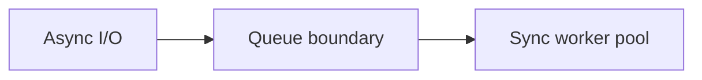

# 136. What is the Half-Sync/Half-Async pattern?

> **Section:** 7. Concurrency Patterns · **Level:** Practitioner to architect

## TL;DR

Half-Sync/Half-Async separates async I/O from synchronous worker processing through a queue.

## How it works

The asynchronous layer handles events or I/O, while a synchronous worker-pool layer performs blocking or business processing, often separated by a queue. The boundary isolates execution models and smooths bursts. Queue capacity, rejection, ordering, and error propagation are essential to avoid merely moving overload between layers.

## Example

```java
ioHandler.onReadable(() -> workQueue.offer(request));
```

## Mermaid diagram



## Architect insight

Size worker pool and queue together against service time and latency targets.

## Common pitfall

Unbounded handoff queues relocate overload rather than prevent it.

## Related questions

- [Q 135 — What is Leader-Follower?](<135.%20What%20is%20Leader-Follower.md>)
- [Q 137 — How does batching help?](<137.%20How%20does%20batching%20help.md>)
- [Section guide](<README.md>)