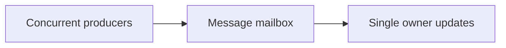

# 138. How does async message passing reduce contention?

> **Section:** 7. Concurrency Patterns · **Level:** Practitioner to architect

## TL;DR

Async messages replace shared mutation with serialized ownership transitions.

## How it works

Instead of many threads mutating the same object, producers submit immutable messages to a single owner or partitioned consumers. This serializes only the owner’s state transitions and avoids shared locks. It trades lock contention for queueing, copying, ordering, and backpressure costs.

## Example

```java
mailbox.offer(new Update(accountId, delta));
```

## Mermaid diagram



## Architect insight

Partition ownership by key to keep unrelated updates independent.

## Common pitfall

A hot owner or unbounded mailbox recreates a bottleneck in queue form.

## Related questions

- [Q 137 — How does batching help?](<137.%20How%20does%20batching%20help.md>)
- [Q 139 — Benefits of immutability in multithreaded design](<139.%20Benefits%20of%20immutability%20in%20multithreaded%20design.md>)
- [Section guide](<README.md#138-how-does-async-message-passing-reduce-contention>)