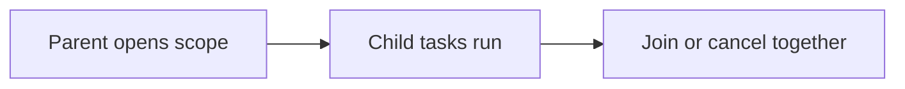

# 140. What is structured concurrency?

> **Section:** 7. Concurrency Patterns · **Level:** Practitioner to architect

## TL;DR

Structured concurrency scopes child-task lifetime, cancellation, joining, and failures under a parent.

## How it works

Structured concurrency treats related child tasks as a lexical unit: the parent scopes their lifetime, joins or cancels them together, and observes failures coherently. Java's structured-concurrency API availability and status depend on the JDK release; check the target JDK's documentation and preview requirements before adopting it.

## Example

```java
// API shape varies: use StructuredTaskScope as documented for the target JDK.
```

## Mermaid diagram



## Architect insight

Pin and test against deployment JDK; preview status and API shape depend on release.

## Common pitfall

Do not assume a newer JDK example is finalized or compiles on your production JDK.

## Related questions

- [Q 139 — Benefits of immutability in multithreaded design](<139.%20Benefits%20of%20immutability%20in%20multithreaded%20design.md>)
- [Section guide](<README.md#140-what-is-structured-concurrency>)