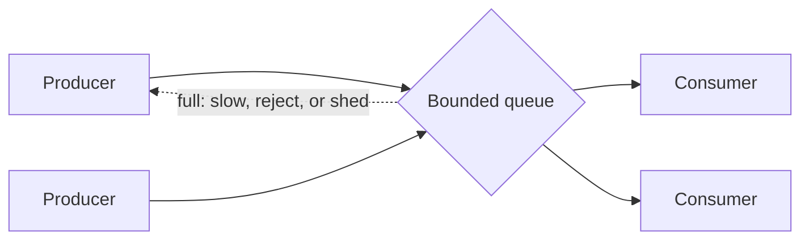
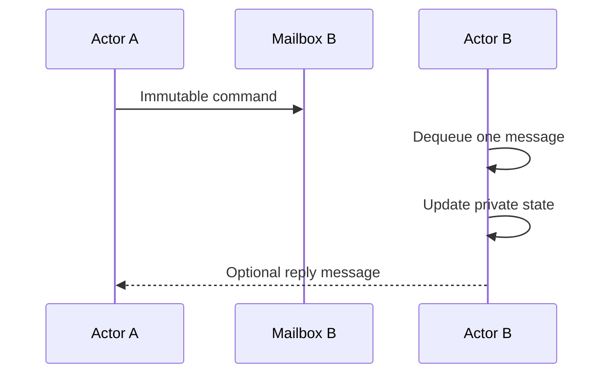
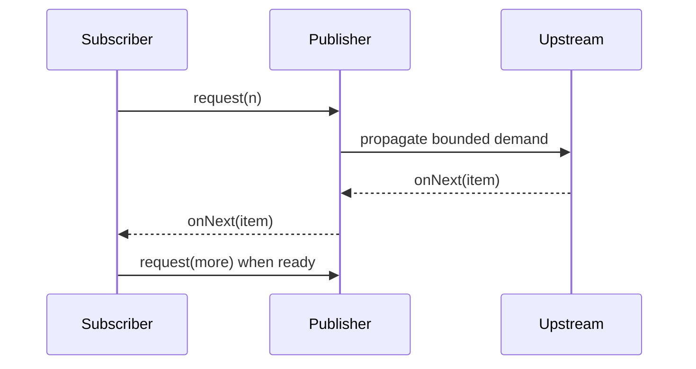
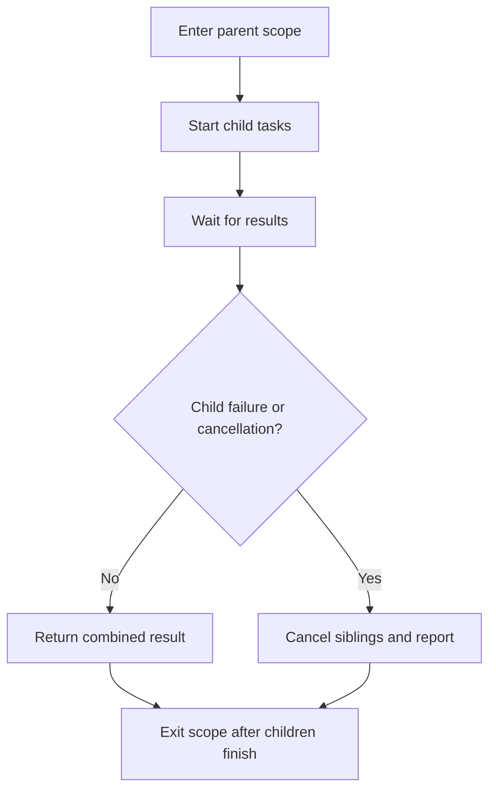

# 7. Concurrency Patterns

> Complete guide to questions 121–140 in the [master index](../00-INDEX.md). Patterns are design tools, not guarantees of performance; choose based on ownership, load, ordering, and failure semantics.

**Related code:** [`producerconsumer`](../../src/com/java/producerconsumer/), [`javasynchronize`](../../src/com/java/javasynchronize/).

## Answers

### 121. What is Producer-Consumer?

Producers create work and consumers process it through a handoff mechanism, decoupling their rates and lifecycles. A queue can buffer bursts; a bounded queue makes capacity and overload behavior explicit. Define shutdown, poison/end-of-stream signaling, delivery guarantees, and what happens to queued work on failure.

### 122. Producer-Consumer with `BlockingQueue`

Use `put`/`take` for natural blocking or timed `offer`/`poll` when deadlines matter. A bounded queue limits in-flight work and propagates backpressure to producers. Handle interruption as cancellation or restore the interrupt flag; do not swallow it. For multiple consumers, make task completion and shutdown accounting explicit.

### 123. What is the Reader-Writer pattern?

It permits concurrent readers while excluding writers, improving throughput when reads dominate and data is shared. It complicates fairness, writer starvation, lock upgrading, and snapshot semantics. Use it only when the read/write ratio and critical-section cost justify it; immutable snapshots or copy-on-write can be simpler.

### 124. Reader-Writer with `ReadWriteLock`

Guard reads with `readLock()` and mutations with `writeLock()`, using `try/finally` for each. Several readers coexist; a writer is exclusive. Do not attempt read-to-write upgrade while holding a read lock. For downgrade, acquire write, perform update, acquire read, then release write.

### 125. Fork/Join divide and conquer

Split a large problem into independent subtasks, fork some, compute one locally, then join and combine results. Work stealing balances tasks across workers. Set a minimum task size so overhead does not dominate; avoid shared mutable accumulation and unmanaged blocking.

### 126. What is the Actor model?

An actor owns private state, processes one message at a time, and communicates with other actors by asynchronous messages. Mailboxes serialize each actor's state transitions, reducing shared-memory locking. Actors still need mailbox capacity, supervision, delivery, ordering, and restart policies.

### 127. How do actors avoid shared-state issues?

State is mutated only by its owning actor; other components send messages rather than accessing fields. This confines synchronization to message delivery. Do not leak mutable references in messages, and remember that actors can still fail, process stale messages, deadlock through request cycles, or overload unbounded mailboxes.

### 128. Immutability's role

Immutable values can be safely shared after construction because their state cannot race with later mutation. They reduce the number of synchronization protocols and make message passing easier to reason about. Deep immutability matters: a final reference to a mutable collection does not make the collection immutable.

### 129. What is an event-driven pipeline?

It processes events through stages connected by queues or asynchronous callbacks. Stages can be independently scaled and isolated, but boundaries introduce buffering, ordering, retries, and observability requirements. Specify event ownership, schema, delivery semantics, and overload policy at every stage.

### 130. Reactive Streams as a pipeline

Reactive Streams models asynchronous publishers, subscribers, and processors with a demand protocol. A subscriber requests a number of items; publishers must not emit more than requested. This supports bounded flow across asynchronous stages, while cancellation and terminal errors are part of the protocol.

### 131. What is backpressure?

Backpressure makes downstream capacity influence upstream production instead of allowing an unbounded backlog. It may be expressed as item demand, bounded queues, rejection, shedding, or rate limiting. Choose whether to slow, buffer, drop, or fail and make that policy visible to callers and operators.

### 132. What is the Disruptor pattern?

The LMAX Disruptor is a high-throughput inter-thread messaging design built around a preallocated ring buffer, sequence numbers, and explicit producer/consumer coordination. It reduces allocation and contention in suitable pipelines but requires careful capacity, sequencing, wait strategy, and event reuse discipline. It is not a general-purpose queue replacement.

### 133. What is thread confinement?

Thread confinement gives mutable state to one thread and prevents other threads from accessing it. This avoids synchronization for that state; examples include local variables and carefully scoped thread-local state. Thread pools reuse workers, so thread-local values must be cleared to prevent leaks and cross-request data contamination.

### 134. What is thread-per-message?

Each incoming message/request is handled by its own thread or task, making control flow straightforward and isolating blocking work. Platform threads are costly at very high concurrency; virtual threads can make this model more practical for blocking I/O. Still bound downstream resources and do not equate one thread with one CPU core.

### 135. What is Leader-Follower?

A group of workers share an event source: one leader waits for the next event, then promotes a follower and handles or dispatches that event. This can reduce contention around event selection and thread wakeups. The design adds role handoff complexity; most applications should use a tested event-loop or executor framework.

### 136. What is Half-Sync/Half-Async?

The asynchronous layer handles events or I/O, while a synchronous worker-pool layer performs blocking or business processing, often separated by a queue. The boundary isolates execution models and smooths bursts. Queue capacity, rejection, ordering, and error propagation are essential to avoid merely moving overload between layers.

### 137. How does batching help?

Batching amortizes per-item scheduling, I/O, locking, and protocol overhead and can improve throughput. It increases latency for early items, memory use, and retry blast radius. Use bounded batch sizes and maximum wait times, then tune using throughput and tail-latency measurements.

### 138. How does async message passing reduce contention?

Instead of many threads mutating the same object, producers submit immutable messages to a single owner or partitioned consumers. This serializes only the owner’s state transitions and avoids shared locks. It trades lock contention for queueing, copying, ordering, and backpressure costs.

### 139. Benefits of immutability in multithreaded design

Immutable objects eliminate races on their fields after construction, support safe sharing, and simplify caching and retries. They can make updates allocation-heavy; persistent data structures or atomic replacement of whole snapshots can help. Ensure construction is safe and do not expose mutable internals.

### 140. What is structured concurrency?

Structured concurrency treats related child tasks as a lexical unit: the parent scopes their lifetime, joins or cancels them together, and observes failures coherently. Java's structured-concurrency API availability and status depend on the JDK release; check the target JDK's documentation and preview requirements before adopting it.

## Diagrams

### Bounded producer-consumer flow

### Actor ownership and message passing

### Reactive demand propagation

### Structured task lifetime

## Design checklist

- Define queue capacity and overload behavior at each asynchronous boundary.
- Make ownership explicit: identify which thread, actor, or stage may mutate each state object.
- Specify ordering, cancellation, retry, and shutdown semantics, not only the happy path.
- Measure the end-to-end latency added by buffering and batching.
