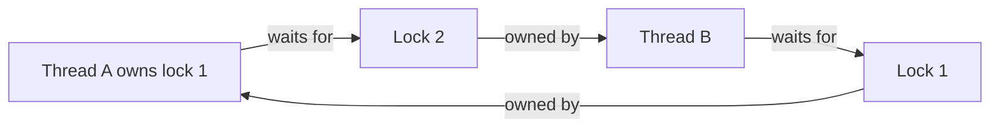

# 141. What is a deadlock?

> **Section:** Performance and Debugging · **Related:** [157. How can deadlocks be prevented](157.%20How%20can%20deadlocks%20be%20prevented.md)

## TL;DR

A deadlock is a cycle of threads that cannot proceed because each waits for a resource held by another thread in that cycle.

## How it happens

For example, thread A holds `lock1` and waits for `lock2`, while thread B holds `lock2` and waits for `lock1`. Classic lock deadlock involves mutual exclusion, hold-and-wait, no preemption, and circular wait. Similar cycles can involve futures, executor capacity, callbacks, or application resources—not just Java monitors.

## Practical insight

A deadlocked thread is usually blocked, but thread state alone does not prove a deadlock. Capture a thread dump and identify the full wait-for cycle. Establish one global lock order, keep critical sections short, and avoid calling unknown code while holding locks.

**Pitfall:** Adding a timeout may reveal a stall but does not automatically restore invariants after partially completed work.

## Related questions

- [142. How can you detect deadlocks](142.%20How%20can%20you%20detect%20deadlocks.md)
- [157. How can deadlocks be prevented](157.%20How%20can%20deadlocks%20be%20prevented.md)
