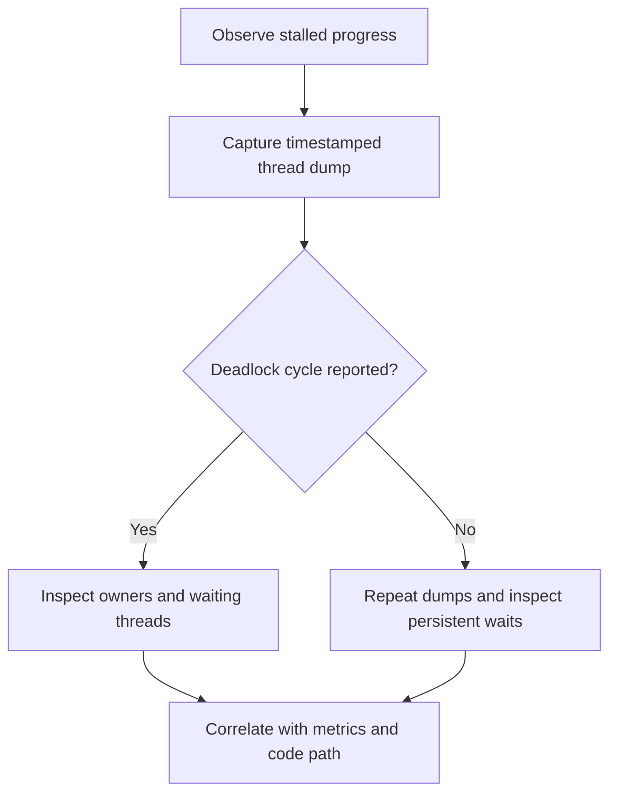

# 142. How can you detect deadlocks?

> **Section:** Performance and Debugging · **Related:** [141. What is a deadlock](141.%20What%20is%20a%20deadlock.md)

## TL;DR

Capture JVM thread dumps during the symptom and inspect reported cycles, lock owners, and repeated waiting stacks.

## Commands and API

```shell
jcmd <pid> Thread.print
# Alternative:
jstack <pid>
```

`ThreadMXBean.findDeadlockedThreads()` detects cycles involving monitors and ownable synchronizers; `findMonitorDeadlockedThreads()` checks monitor cycles only. A typical investigation samples multiple dumps a few seconds apart, then correlates them with request latency, queue depth, and logs.



## Practical insight

An intermittent deadlock can disappear before one snapshot. Repeated dumps distinguish persistent waits from normal short-lived blocking. Thread dumps diagnose JVM-level waits but may not explain an application-level dependency cycle by themselves.

**Pitfall:** A large number of `WAITING` threads is not proof of deadlock; executor workers often wait normally for tasks.

## Related questions

- [148. How do you analyze a thread dump](148.%20How%20do%20you%20analyze%20a%20thread%20dump.md)
- [157. How can deadlocks be prevented](157.%20How%20can%20deadlocks%20be%20prevented.md)
