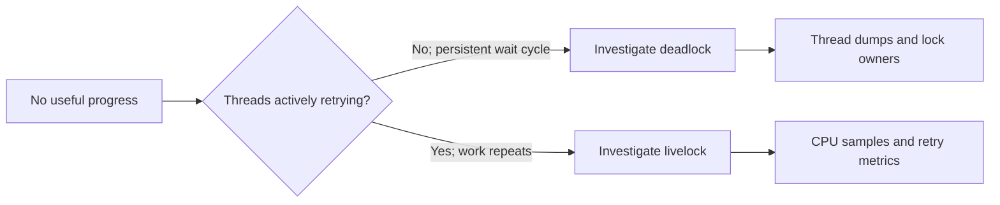

# 144. How does livelock differ from deadlock?

> **Section:** Performance and Debugging · **Related:** [143. What is livelock](143.%20What%20is%20livelock.md)

## TL;DR

Deadlocked threads are stuck waiting in a cycle; livelocked threads keep running but make no useful progress. Both are progress failures.

| Signal | Deadlock | Livelock |
| --- | --- | --- |
| Thread activity | Usually blocked/waiting | Repeatedly runnable/active |
| CPU | Often low for the affected threads | Can be high |
| Evidence | Lock owners and wait-for cycle | Retry stacks, repeated actions, flat completion rate |

## Practical insight

Use multiple thread dumps, CPU profiles, and business-level progress metrics together. The JVM's deadlock detector can identify some lock cycles, but it cannot label every application-level livelock.

**Pitfall:** Treating `RUNNABLE` as proof of useful progress—hot spinning and repeated retries also appear runnable.

## Related questions

- [143. What is livelock](143.%20What%20is%20livelock.md)
- [148. How do you analyze a thread dump](148.%20How%20do%20you%20analyze%20a%20thread%20dump.md)
