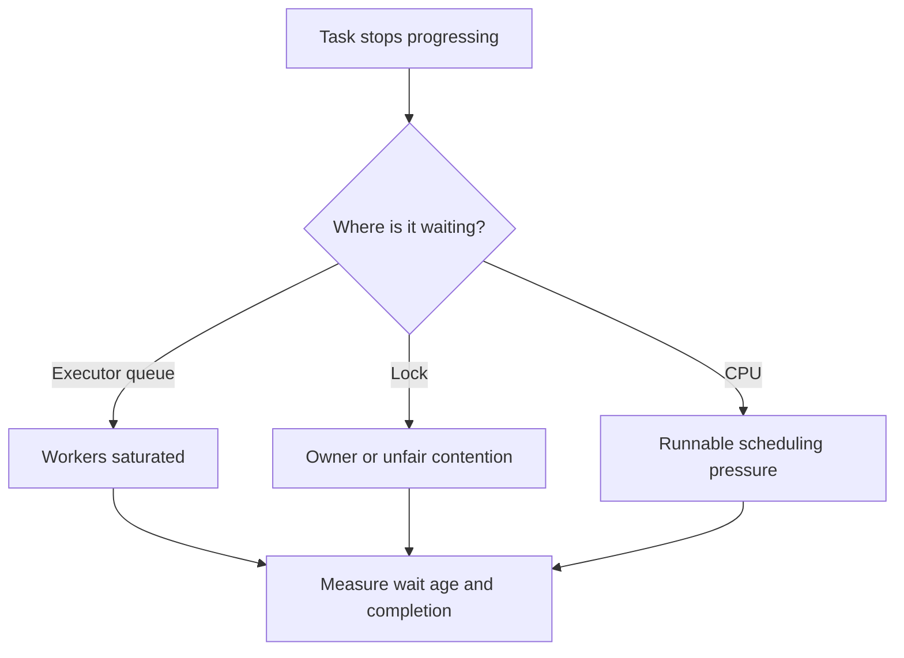

# 145. What is thread starvation?

> **Section:** Performance and Debugging · **Related:** [146. How can starvation be prevented](146.%20How%20can%20starvation%20be%20prevented.md)

## TL;DR

Starvation occurs when a thread is continually denied CPU time, executor capacity, a lock, or another resource it needs to make progress.

## Causes and diagnosis

Unfair scheduling, long-running tasks, priority choices, a saturated shared executor, or monopolized locks can all starve work. Measure task age, queue wait, lock wait, and completion rate. A thread state is only a snapshot; persistent wait duration and repeated samples are more revealing.

## Practical insight

Separate workloads with different latency or blocking behavior, bound task duration, and use quotas or admission control. Fair locks may help a demonstrated lock-starvation problem, but can reduce throughput and do not make OS thread scheduling fair.

**Pitfall:** Increasing pool size without identifying the constrained resource can move starvation downstream rather than fix it.

## Related questions

- [146. How can starvation be prevented](146.%20How%20can%20starvation%20be%20prevented.md)
- [159. What is thread oversubscription](159.%20What%20is%20thread%20oversubscription.md)
