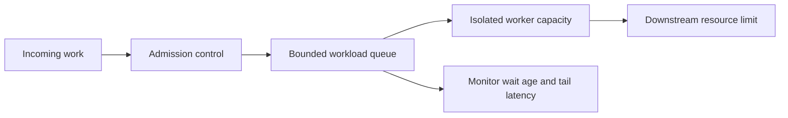

# 146. How do you prevent starvation in scheduling?

> **Section:** Performance and Debugging · **Related:** [145. What is thread starvation](145.%20What%20is%20thread%20starvation.md)

## TL;DR

Prevent starvation by bounding work, isolating workloads, limiting admission, and monitoring wait age—not merely by adding threads.

## Practical measures

- Keep shared-executor tasks short; move blocking work to an explicitly bounded executor.
- Apply quotas or admission control so one workload cannot consume all workers or downstream connections.
- Use fair locks or queues only when measurements show unfair access is the cause.
- Track oldest task age, queue wait, lock wait, and tail latency.

## Architect insight

Fairness is a trade-off: ordering can improve progress guarantees but add handoff overhead and reduce throughput. Set limits that reflect the actual scarce resource, then test both steady-state performance and recovery after overload.

**Pitfall:** An unbounded queue can hide saturation as ever-growing delay; it does not create capacity.

## Related questions

- [145. What is thread starvation](145.%20What%20is%20thread%20starvation.md)
- [147. What is fairness in thread scheduling](147.%20What%20is%20fairness%20in%20thread%20scheduling.md)
