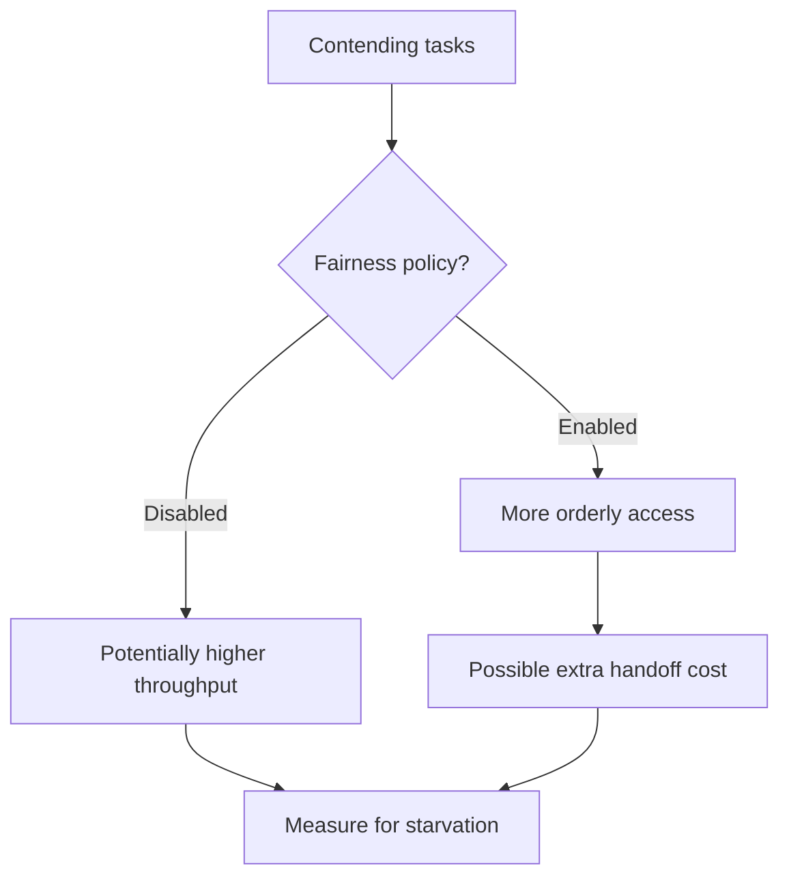

# 147. What is fairness in thread scheduling?

> **Section:** Performance and Debugging · **Related:** [146. How can starvation be prevented](146.%20How%20can%20starvation%20be%20prevented.md)

## TL;DR

Fairness means contenders get opportunities according to a policy, often approximating arrival order or preventing indefinite postponement.

Java does not guarantee portable OS scheduling fairness. Some synchronizers, such as `ReentrantLock`, can be constructed with a fairness policy; that policy governs lock acquisition, not CPU time or end-to-end request fairness.

## Practical insight

Choose fairness based on a measured progress requirement, then benchmark throughput and tail latency under contention. A fair lock cannot compensate for a saturated executor, OS scheduling delays, or an overloaded downstream service.

**Pitfall:** “Fair lock” does not mean a global guarantee that every thread runs or every request completes in order.

## Related questions

- [145. What is thread starvation](145.%20What%20is%20thread%20starvation.md)
- [146. How can starvation be prevented](146.%20How%20can%20starvation%20be%20prevented.md)
