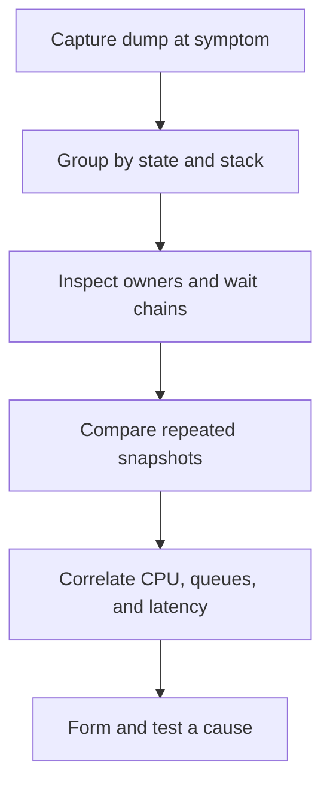

# 148. How do you analyze thread dumps?

> **Section:** Performance and Debugging · **Related:** [149. How do you identify blocked threads](149.%20How%20do%20you%20identify%20blocked%20threads.md)

## TL;DR

Take multiple timestamped dumps during the symptom; group repeated stacks, inspect states and lock ownership, then correlate with metrics.

```shell
jcmd <pid> Thread.print
```

Look for `BLOCKED` threads and their monitor owners, `WAITING`/`TIMED_WAITING` stacks, executor workers and queues, repeated application frames, and deadlock-cycle reports. Compare snapshots to see whether stacks and waits persist. Correlate them with per-thread CPU, request percentiles, queue depth, and logs.



## Practical insight

A dump is a point-in-time observation, not a root cause. Capture safely and repeatedly when intermittent behavior is suspected.

**Pitfall:** Counting threads or treating every wait as a fault misses normal worker polling and brief contention.

## Related questions

- [142. How can you detect deadlocks](142.%20How%20can%20you%20detect%20deadlocks.md)
- [149. How do you identify blocked threads](149.%20How%20do%20you%20identify%20blocked%20threads.md)
