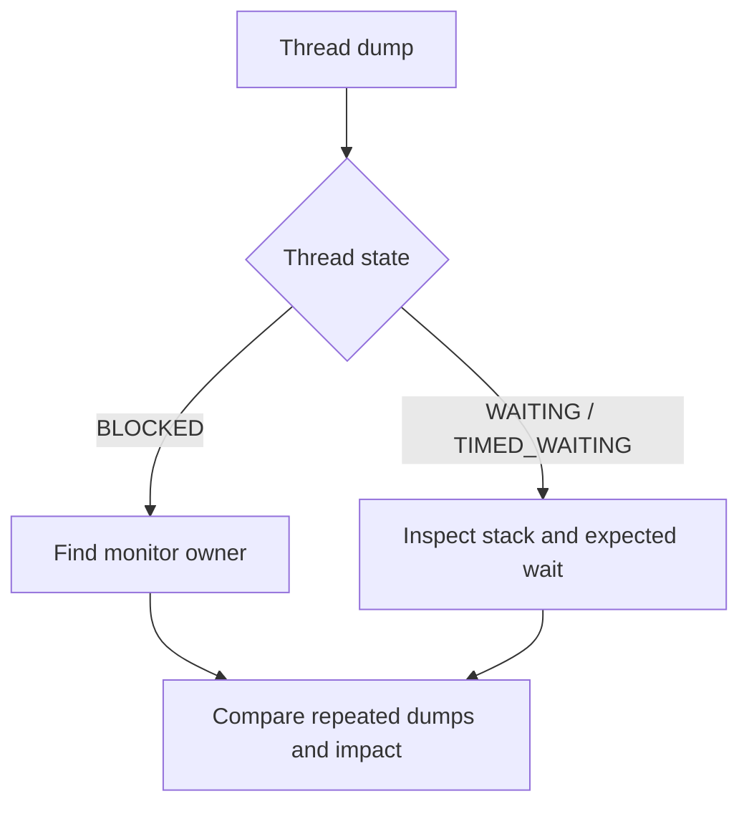

# 149. How do you identify blocked threads?

> **Section:** Performance and Debugging · **Related:** [148. How do you analyze a thread dump](148.%20How%20do%20you%20analyze%20a%20thread%20dump.md)

## TL;DR

Inspect repeated thread dumps for persistent `BLOCKED` threads, the monitor they need, and the thread that owns it.

`BLOCKED` means waiting to enter a Java monitor. `WAITING` and `TIMED_WAITING` can instead be normal queue polling, condition waits, sleeps, or I/O-related waits; inspect the stack and duration before concluding. Compare snapshots and service progress.

## Practical insight

Use `jcmd <pid> Thread.print` and correlate owners with application frames and lock-wait metrics. Persistent blockage affecting request completion is more actionable than a single snapshot.

**Pitfall:** `RUNNABLE` does not guarantee useful work, and `WAITING` does not by itself indicate a defect.

## Related questions

- [148. How do you analyze a thread dump](148.%20How%20do%20you%20analyze%20a%20thread%20dump.md)
- [154. CPU versus lock bottlenecks](154.%20CPU%20versus%20lock%20bottlenecks.md)
