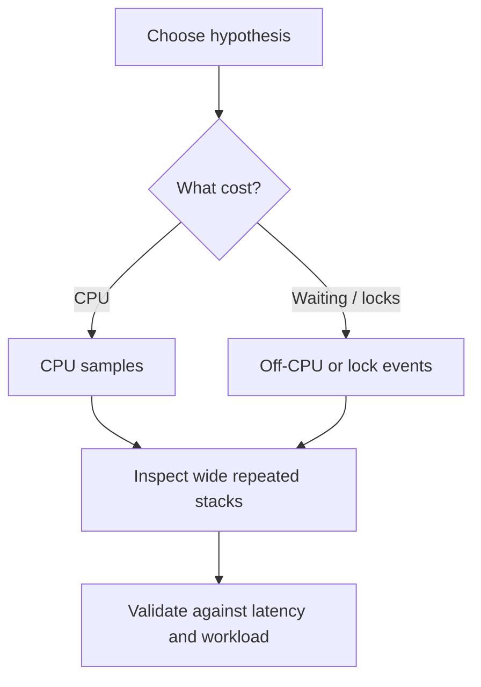

# 150. How do flame graphs help in debugging concurrency?

> **Section:** Performance and Debugging · **Related:** [153. Java thread-profiling tools](153.%20Java%20thread-profiling%20tools.md)

## TL;DR

A flame graph aggregates sampled stacks; a frame's width indicates how often it appears in samples, not the duration of one call.

CPU flame graphs help identify frequently sampled computation. Off-CPU or lock-event profiles reveal time spent waiting. Select the event type for the hypothesis, collect under representative load, and compare with wall-clock latency and throughput. JFR and tools such as async-profiler can capture different kinds of evidence.

## Architect insight

Sampling reduces instrumentation overhead but is statistical, so rare events may be missed. Profile realistic traffic and validate a proposed optimization with a before/after benchmark.

**Pitfall:** A wide frame is not automatically the root cause; it may be a frequently sampled caller or runtime frame.

## Related questions

- [153. Java thread-profiling tools](153.%20Java%20thread-profiling%20tools.md)
- [158. How do you find contention hotspots](158.%20How%20do%20you%20find%20contention%20hotspots.md)
