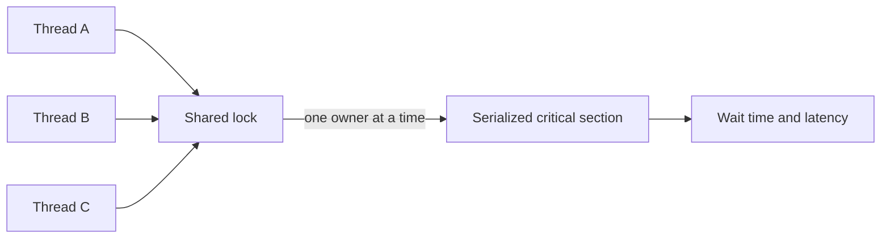

# 151. What is lock contention?

> **Section:** Performance and Debugging · **Related:** [152. How can lock contention be reduced](152.%20How%20can%20lock%20contention%20be%20reduced.md)

## TL;DR

Lock contention occurs when multiple threads compete for an exclusive or limited synchronization resource.

Contenders wait or repeatedly hand off access; the protected work becomes serialized and cache-coherence traffic can increase. The result may be higher tail latency and lower throughput even when total CPU is not saturated. A high acquisition count alone does not establish impact—measure wait duration and affected work.

## Practical insight

Use JFR lock events, profiler data, and thread dumps to identify the specific lock, owner, and critical-section path. Compare lock waits with application throughput and percentiles.

**Pitfall:** More threads do not increase parallelism inside one exclusive critical section and may increase contention.

## Related questions

- [152. How can lock contention be reduced](152.%20How%20can%20lock%20contention%20be%20reduced.md)
- [158. How do you find contention hotspots](158.%20How%20do%20you%20find%20contention%20hotspots.md)
